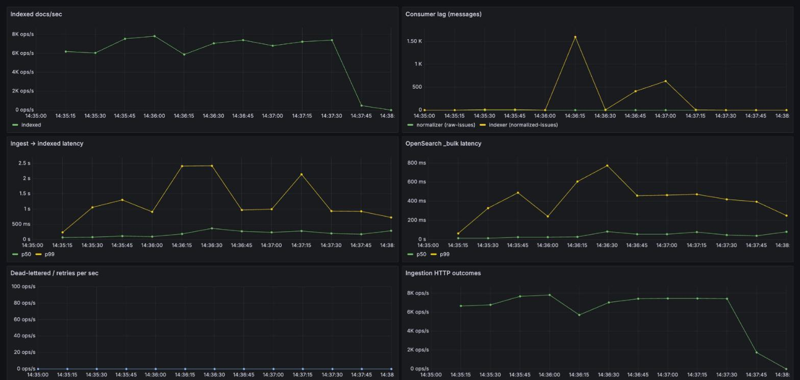
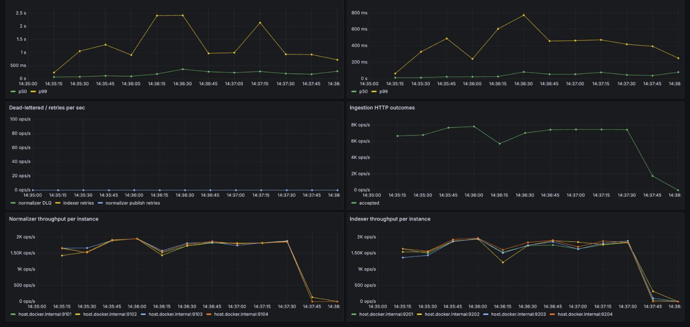

# Benchmarks and fault injection

All numbers are from one machine: Apple M4 (10 cores), 16 GB RAM, Docker Desktop (10 CPUs / 7.6 GB).
Kafka (1 broker) and OpenSearch (1 node, 2 GB heap, 0 replicas) run in Docker; the pipeline services,
the load generator and the verifier run on the same host as native processes. Everything competes for the
same cores, so treat these as laptop numbers, not cluster numbers. Raw results are in `docs/results/*.jsonl`.

Reproduce: `docker compose up -d kafka opensearch kafka-init prometheus grafana`, then
`make bench-scaling`, `scripts/bench/run.sh ...`, `make chaos`. Dashboard: http://localhost:3000 (IssueIQ pipeline).

## 1. Throughput

Synthetic events (~600 B each) written straight to `raw-issues`, flowing normalizer -> `normalized-issues` -> indexer -> OpenSearch.
"Sustained" is the median per-second growth of searchable docs over the middle 60% of the run.

| Version | Partitions / normalizers / indexers | Sustained events/sec |
|---|---|---|
| Original code (HEAD before this work) | 1 / 1 / 1 | **~1** |
| After batching + `_bulk` | 1 / 1 / 1 | 12.2k |
| | 2 / 2 / 2 | 21.2k |
| | 4 / 4 / 4 | **33.3k** |
| | 8 / 8 / 8 | 23.2k |

Median of 3 runs of 1,000,000 events each (individual runs in `scaling.jsonl`); every run indexed all 1M events with 0 missing.

Why the original was ~1 event/s: the services published each message through a `kafka-go` writer left at its default
`BatchTimeout` of 1s while calling `WriteMessages` synchronously, so every message waited ~1s for a batch that never filled.
Fixes: batched fetch/publish/commit, `_bulk` indexing, explicit 5 ms writer batch timeout.

Scaling is near-linear from 1 to 4 (1.7x, 2.7x) and **regresses at 8**. That is the host running out of cores
(8+8 consumers, the load generator at ~30k events/s, Kafka and OpenSearch share 10 cores), not a pipeline property.
I did not isolate it further; a real scaling claim past 4 needs the load generator and OpenSearch on separate machines.

## 2. Latency at a sustained, non-saturating load

4 partitions, 4 normalizers, 4 indexers. Latency under saturation is just queue depth, so this is measured below it.

| Entry point | Load | Ingest -> indexed p50 / p99 | Send -> first search hit p50 / p99 / max |
|---|---|---|---|
| Kafka direct | 17.8k events/s for 60 s (1.07M events, target 20k) | 74 ms / 251 ms | 733 ms / 1312 ms / 1492 ms |
| HTTP `POST /ingest` | 8.0k events/s for 45 s (359k events) | 49 ms / 141 ms | 655 ms / 1227 ms / 1253 ms |

"Ingest -> indexed" is `indexed_at - ingested_at` on every document (bulk acknowledgement). "Send -> first search hit" is measured by
probe events (one per 200 ms, 300 / 225 samples) that are sent through the real path and polled via `_search`; it includes
OpenSearch's 1 s `refresh_interval`, which dominates it. A p99 of ~1.3 s "ingest-to-searchable" is therefore mostly the refresh setting.

### Grafana dashboard under load

Dashboard `IssueIQ pipeline` (provisioned from `observability/`), showing a 150 s run through the HTTP ingestion service at ~7.3k events/s,
4 partitions, 4 normalizers, 4 indexers (all 1.09M events indexed, 0 missing). Per-instance panels show the four consumers sharing load evenly;
the DLQ / retry panel is flat because nothing failed.

Caveat: this run is noticeably slower on latency than the table above. Prometheus (scraping 25 targets every 5 s), Grafana and a browser were
running on the same laptop, and the whole-run p99 ingest-to-indexed was 1.25 s (p99 send-to-searchable 2.6 s), with spikes to ~2.4 s visible in the panel,
versus 141 ms for the same rate in the table. The table numbers are best case, measured with only the pipeline, Kafka and OpenSearch running; on a
shared machine the tail moves a lot, which is also why I would not read the 8-partition regression in section 1 as a pipeline limit.

## 3. Fault injection

Harness: `tools/chaos`. Each run starts 1 ingestion + 2 normalizers + 2 indexers on a 4-partition topic, sends 30,000 events
over HTTP at 2,500/s (client retries failed sends, like a well-behaved client), injects faults, then compares the set of
acknowledged (HTTP 202) events to the documents in OpenSearch by ID. Pass requires: no missing, no unexpected, no duplicate documents,
and every injected malformed event present in the DLQ. Services killed with SIGKILL are restarted after 1 s.

| Scenario | Runs | Events acked and verified | Lost | Duplicate docs | Redelivered writes (absorbed by idempotent upsert) |
|---|---|---|---|---|---|
| 5x SIGKILL of random normalizer/indexer | 5 | 150,000 | 0 | 0 | 10-52 per run |
| Kafka broker restart (`docker restart`) | 5 | 150,000 | 0 | 0 | 75-149 per run |
| OpenSearch restart | 5 | 150,000 | 0 | 0 | 0-59 per run |
| 2% malformed events (garbage JSON, missing title, wrong shape) | 5 | 150,000 | 0 | 0 | 0 |
| Combined: kill + Kafka restart + kill + OpenSearch restart + 2% malformed | 5 | 150,000 | 0 | 0 | 47-81 per run |
| DLQ replay (5,000 dead-lettered events replayed twice) | 5 | 25,000 | 0 | 0 | 0 |
| **Total** | **30** | **775,000** | **0** | **0** | |

Notes on what this does and does not show:

- **Duplicates.** The pipeline is at-least-once: killed consumers and broker restarts redeliver, and `kafka-go`'s writer can
  retry a batch. Those show up as "redelivered writes" (the sum of `_version - 1` over the run's documents). They cannot create duplicate documents because
  the document `_id` is `sha256(source:source_id)`. The 0 is measured by scanning every document of the run, not assumed.
- **DLQ.** Malformed events were dead-lettered exactly once in the malformed scenario (+600 for 600 injected). In the combined scenario
  runs 2-5 show +601: a SIGKILL landed between a DLQ write and its offset commit, so one dead-letter record was written twice. DLQ is also at-least-once.
- **The OpenSearch outage was short.** `docker restart issueiq-opensearch` took a few seconds under this load; the indexers logged
  connection resets and retried, but this does not test a minutes-long outage.
- **Not tested:** disk loss, multi-broker clusters / replication, network partitions, producer-side loss when the HTTP client gives up
  (the client here retries until acknowledged), clock skew.

## What the fault testing changed in the code

- The indexer used to send a message to the DLQ on *any* OpenSearch error, including OpenSearch being down. It now retries transient
  failures (connection errors, 429, 5xx) with backoff and only dead-letters documents OpenSearch permanently rejects (4xx) or messages that cannot be parsed.
- The normalizer used to exit on a failed publish, and both consumers exited on a failed offset commit. Publish is now retried; a failed
  commit is logged and the batch is simply redelivered.
- Producers used `LeastBytes`, which ignores the message key, so the README's "same issue, same partition" claim was false once there is
  more than one partition. They now use a key hash.
- `make replay-dlq` was a stub. `tools/replay` is real: it reads `dead-letter` through a committed consumer group, re-publishes to the topic
  recorded in the envelope's new `source_topic` field, and can filter by failure reason.
- A bug found in the replay tool by the harness itself: the first read timed out before the consumer group had joined, replaying nothing. Fixed.
